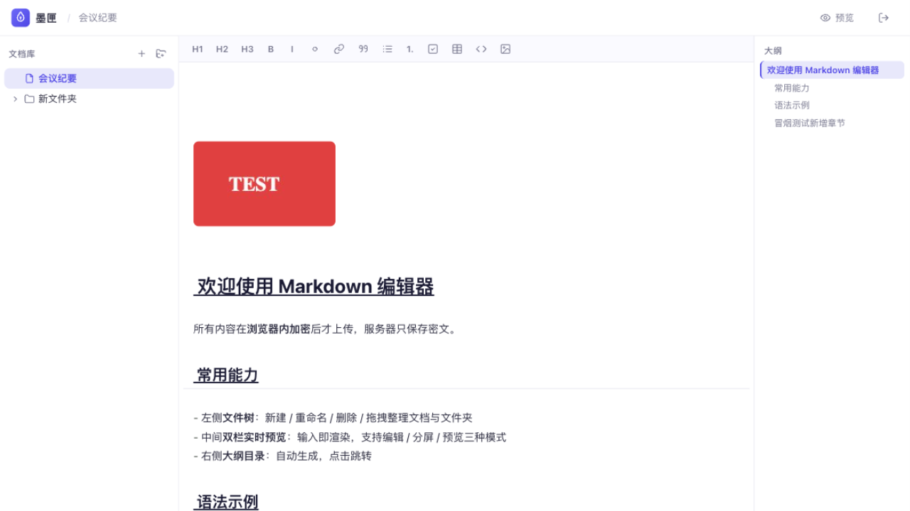

# 墨匣 InkVault

本地 Markdown 笔记应用（macOS / Windows），不联网、不上传。笔记以 Markdown 文件保存在用户主目录的 `InkVault` 文件夹，文件树就是真实的文件夹结构，图片存在 `InkVault/.assets/`。



## 功能

- 所见即所得编辑：标题、加粗、代码块、引用、表格、任务列表在编辑框内直接渲染。光标行也保持渲染，只有光标贴着 `#`、`**` 这类标记时才显示源码。顶栏可切换纯预览阅读
- 文件树即磁盘目录：新建、重命名、删除、拖拽归类，全部直接同步到文件系统；文件按名称排序
- 插入图片：粘贴截图、拖拽文件或工具栏按钮。图片先压缩（最长边 1600px、JPEG 82%，SVG/GIF 原样保留，原图限 8MB）再写入本地，编辑框和预览里直接显示
- 大纲：随内容实时更新，点击跳转，随滚动高亮
- 自动保存：停顿 1.5 秒后写入磁盘文件

## 技术栈

Tauri 2（Rust）+ React 18 + TypeScript + Vite，CodeMirror 6，markdown-it + highlight.js，zustand。Rust 端只提供本地文件命令，路径全部校验必须落在 InkVault 目录内。

## 开发

```bash
npm install
npm run tauri dev    # 需要本机安装 Rust 工具链（rustup）
```

## 打包发布

推送 `v*` 格式的 tag（如 `v0.1.0`）触发 GitHub Actions，用 tauri-action 构建三个产物：Apple Silicon dmg、Intel dmg、Windows NSIS 安装包，进入 Releases 草稿，确认后发布。

应用未做代码签名：macOS 首次打开右键选"打开"，Windows 遇 SmartScreen 选"仍要运行"。

## 目录结构

```
src/
├── App.tsx            # 工作区布局（顶栏/文件树/编辑区/大纲）
├── lib/
│   ├── desktop.ts     # Tauri invoke 封装（本地文件后端）
│   ├── livePreview.ts # CodeMirror 所见即所得渲染插件
│   ├── assets.ts      # 图片压缩与本地写入
│   ├── markdown.ts    # markdown-it 渲染 + 源码大纲提取
│   └── base64.ts
├── store/app.ts       # zustand：文档树、自动保存
└── components/        # FileTree / EditorPane / Preview(+TocPanel) / Icons
src-tauri/
├── src/main.rs        # 本地文件命令（列树/读写/建/改名/移动/删除/图片），含路径安全校验
├── tauri.conf.json
└── capabilities/
.github/workflows/     # 双平台打包发布
```
